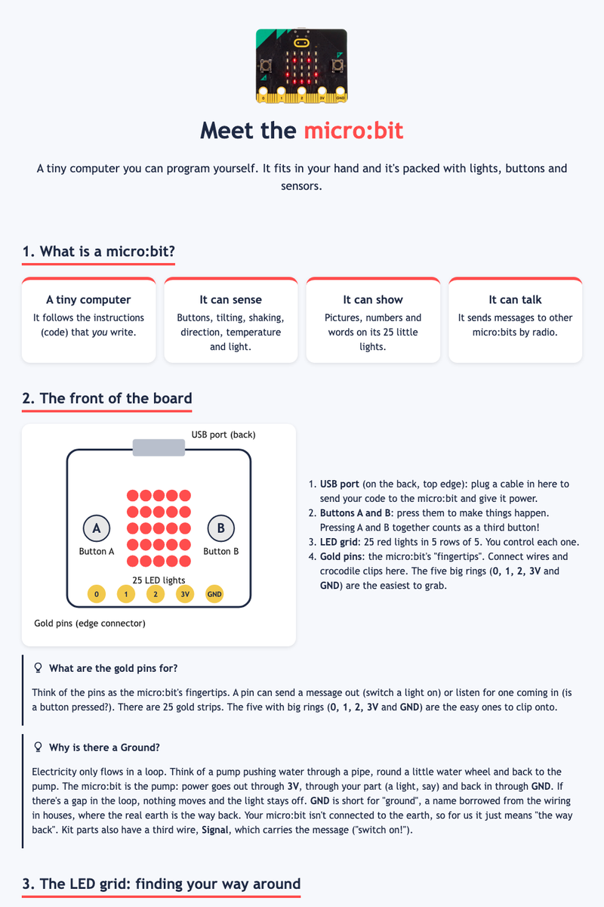
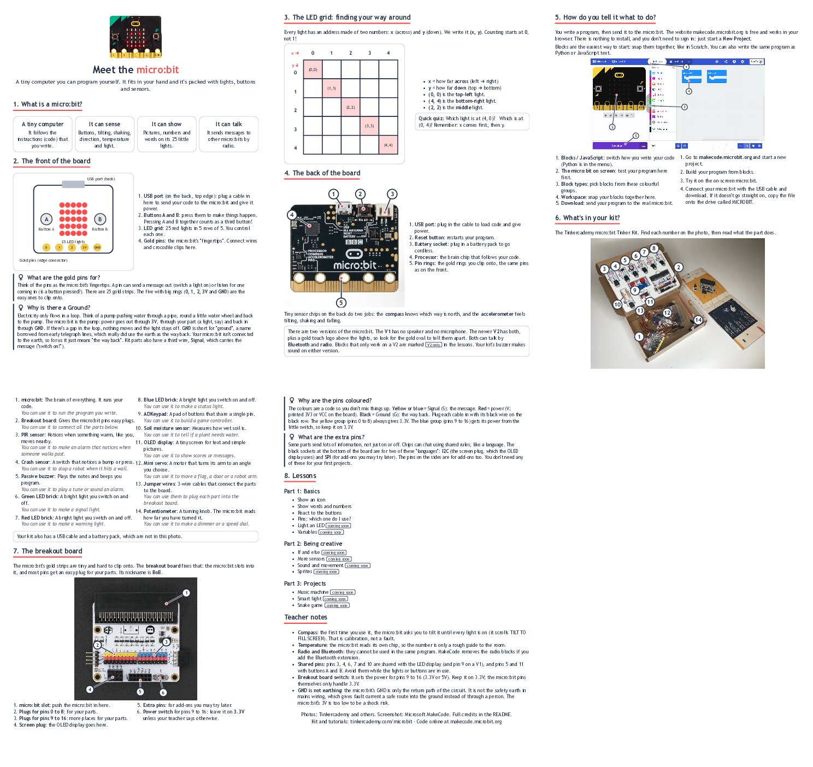

# Meet the micro:bit

A friendly, printable guide to the BBC micro:bit, made for kids aged 10-14 and the Coding Pirates volunteers who teach them.

Kids write their programs in [MakeCode](https://makecode.microbit.org/), snapping blocks together much like in Scratch. This project covers the basics: what the board and the kit parts are, how to read the LED grid, and how to start coding. Parts 1 and 2 are ready. Part 3, finished projects, is next.

**Live site:** https://mans-metal.github.io/coding-pirates-microbit/



## What is here so far

- **An introduction page:** the front and back of the micro:bit, the LED grid and its (x, y) coordinates, and how to start in MakeCode.
- **The kit:** photos with numbered labels for every part in the Tinkercademy micro:bit Tinker Kit (micro:bit V1), plus the breakout board.
- **Little "light bulb" boxes:** short, plain explanations for things kids always ask, like why there is a Ground and what the gold pins are for.
- **Teacher notes:** a few handy facts at the end.
- **Lessons and reference pages:** Part 1 (basics: icons, text, buttons, pins, LEDs, variables) and Part 2 (being creative: if/else, sensors, sound and movement, sprites), each with block pictures, examples, common mistakes and teacher notes, plus a one-page block cheat sheet.
- **Two languages:** English and Danish.

Coming next: projects like a music machine, a smart light and a simple snake game.

## Using it

Open `index.html` in a browser and pick a language. Nothing to install and no internet needed, except to follow the MakeCode links.

To print, use Print, then Save as PDF (A4). The introduction is 5 pages in English and 6 in Danish.



## Checking the site

Run the automatic checks (Python 3, nothing to install):

```
python3 -m unittest discover -s tests -v
```

They check that English and Danish have the same pages and structure, every link and picture exists, the language switcher works, pages have no scripts or outside resources, and the block pictures are up to date.

## Block pictures

The block pictures in `images/blocks/` are made by a small script. After you change `tools/blocks.py`, run `python3 tools/blocks.py` and commit the new files. The pictures are simplified drawings, so check them against real MakeCode.

## Languages

Each language is a folder with the same pages, for example `en/show-icon.html` and `da/show-icon.html`. Keep the structure, ids and class names identical so the two can be compared, and when you change the English text, update the Danish too.

## Files

- `index.html`: language picker
- `en/index.html`, `da/index.html`: the introduction in English and Danish
- `en/*.html`, `da/*.html`: the lessons and reference pages, one file per page and language (`show-icon`, `show-text`, `buttons`, `pins`, `light-led`, `variables`, `if-else`, `sensors`, `sound-movement`, `sprites`, and the `blocks` cheat sheet)
- `tools/blocks.py`: draws the block pictures in `images/blocks/`
- `tests/`: automatic checks
- `TODO.md`: things to check in real MakeCode
- `style.css`: the styles, shared by both languages
- `images/`: photos and screenshots
- `docs/`: the preview pictures in this README
- `HOSTING.md`: notes for putting it online later

## Got an idea or spotted a mistake?

Please open an issue or a pull request. Lesson ideas from other volunteers are very welcome.

## Credits

- `kit_v1.webp`, `breakout_board.webp`: product photos of the Tinkercademy micro:bit Tinker Kit and GVS breakout board ([Get Hacking](https://gethacking.com/products/micro-bit-tinker-kit)).
- `make_code_start_page.png`: screenshot of [MakeCode for micro:bit](https://makecode.microbit.org/), by Microsoft and the Micro:bit Educational Foundation.
- `microbit_back.jpg`, `smiley_face_microbit.png`: photos of the micro:bit. TODO: add the original source.
- micro:bit is a trademark of the Micro:bit Educational Foundation.
